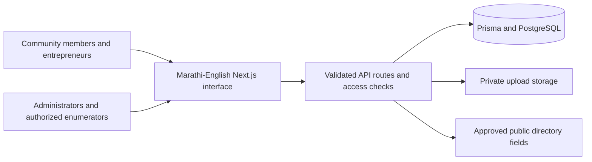

# आगरी समाज · Agri Samaj Community Platform

[](https://github.com/harshgavandit/agri-samaj-community-platform/actions/workflows/ci.yml)
[](LICENSE)

**Live website:** [agri-samaj-community-platform.vercel.app](https://agri-samaj-community-platform.vercel.app)

**An open-source platform built to help the Agri Samaj community connect, support local entrepreneurs, and make community services easier to access.**

आगरी समाजातील उद्योजक, व्यावसायिक, स्वयंसेवक आणि समाजबांधवांना एकत्र जोडण्यासाठी हे मुक्त-स्रोत डिजिटल व्यासपीठ तयार केले आहे. मराठी आणि इंग्रजीमधून व्यवसाय शोधणे, उद्योजकांना प्रोत्साहन देणे, उपक्रमांची माहिती मिळवणे आणि समाजाच्या कार्यात सहभागी होणे हा या प्रकल्पाचा उद्देश आहे.

## Why this project exists

Community businesses grow when people can find and support one another. This project brings business discovery, entrepreneur registration, publications, announcements, and administrative workflows into one accessible Marathi–English website. It is intended to be useful to local entrepreneurs, service providers, community organizations, volunteers, and the people they serve.

Agri Samaj refers to the **Agri community** across many professions and industries. The platform is not limited to agriculture. Its open-source model lets community members inspect the code, improve Marathi content and accessibility, contribute fixes, and adapt the software for local needs.

The platform references the history and programs of Akhil Aagri Samaj Parishad. This repository is a community software initiative; publication of the code does not itself establish institutional endorsement or authorization to represent an organization.

## What the platform does

| For                      | Available features                                                                                                                                                                        |
| ------------------------ | ----------------------------------------------------------------------------------------------------------------------------------------------------------------------------------------- |
| Community members        | Browse approved businesses without an account; search and filter by business category, location, and classification; read publications and announcements; use the community inquiry form. |
| Entrepreneurs            | Create an account, register a business through a five-step application, save and resume drafts, upload private verification documents, and track application or advertisement status.     |
| Community administrators | Review business applications, request revisions, manage categories and advertisement rates, review payments manually, maintain publications and announcements, and resolve inquiries.     |
| Authorized survey teams  | Use an optional restricted census tracker for aggregate household and questionnaire counts. The module is disabled by default.                                                            |
| Contributors             | Improve the interface, Marathi and English wording, accessibility, security, documentation, and automated tests through issues and pull requests.                                         |

This is a working full-stack application: forms persist to a relational database, access checks run on the server, and administrative actions are auditable. New installations start without fabricated businesses, events, publications, or advertising rates.

## Community content and publishing

The 18 October 2026 enhancement adds a Marathi-first homepage with an original coastal SVG illustration, a consistent deep-green and warm-paper visual identity, responsive navigation, searchable community resources, dated news/event views, accessible FAQs, and clearer links between community information and the entrepreneur directory. The illustration is original code; no unlicensed community photography or invented audience figures are used.

- `/about` introduces community identity and sourced organizational information; `/culture` distinguishes language heritage from historical records.
- `/resources` groups education, scholarships, skills, employment and entrepreneurship references with searchable bilingual summaries. Links lead to the responsible official portal; the platform does not promise eligibility, open applications, benefits or employment.
- `/news` separates upcoming and past dated events and includes published announcements. `/initiatives` supports reviewed initiatives, organizational information and verified achievements. The enhancement seeds no people, businesses, testimonials, achievements or events, and does not add registration forms for nonexistent events.
- `/community/[slug]` shows the full bilingual article, sources, review date, historical context, image credit and any source-access limitation. Corrections and proposed contributions use the working inquiry form.
- Directory searches are case-insensitive, support recent/name/oldest sorting, and preserve filters and page state in shareable URLs. Existing registration, draft editing, private documents and approval workflows remain in place. Approval labels refer to the platform administrator. Retained announcements without an attached organizer source carry a notice to confirm current event details before participating.

Administrators open **Content & website** in the administrator navigation (`/admin/community`). The content tab manages About, Culture, Organizations, Education, Resources, Achievements, Initiatives, Events and News. Save incomplete work as **Draft**, complete both languages before **For review**, explicitly verify at least one supporting source before **Published**, and use **Archived** to remove an entry from public pages. Published events also require a date/time and location. Source review notes are public and bilingual; internal editorial notes and reviewer identities remain private. Body text renders as escaped text rather than executable HTML.

Editorial cover images use the existing private upload pipeline and require an administrator upload plus a credit/permission statement. A draft or archived article does not grant anonymous image access. Administrators must own the image or obtain permission; the application records the credit and review acknowledgement but cannot independently establish copyright ownership. PDFs retain their existing private-document rules. Existing publication, business, category, advertisement, payment-review, announcement and inquiry screens remain available.

The **Homepage & settings** tab edits both hero titles/descriptions, a bilingual public notice and an optional public contact email. An empty contact email hides the direct email link while keeping the inquiry form available. Content and settings changes use server-side administrator checks, input validation, database-backed admission limits, revision checks that refuse stale overwrites, and audit records committed with the change.

Two additive migrations introduce `CommunityContent` and `SiteSettings`, twelve curated bilingual reference articles, and public source-provenance notes. They preserve existing application records. References include Marathi Vishwakosh, the historical Thana/Kolaba gazetteers, the Maharashtra Aagri economic development corporation and its government resolution, MahaDBT, the National Scholarship Portal, National Career Service, Skill India, Mahaswayam, SWAYAM, Udyam and Startup India. Historical gazetteer material is explicitly qualified and is not used as evidence of present-day occupations or population. Three heritage articles disclose that official indexed text was checked but direct page access was intermittent. Portal availability and current application notices must be checked with the linked authority; MahaDBT was under maintenance during this review.

The public library currently returns the latest 100 published, source-verified entries; the administrator list returns the latest 200 entries. Introduce paginated content browsing before those limits are approached. Community-specific achievements, contemporary cultural accounts, approved photographs and actual future events still need community-provided evidence and publication permission.

Public routes have page metadata and canonical URLs. `/sitemap.xml` contains public pages, approved businesses and published verified articles; `/robots.txt` and noindex metadata keep account/admin routes out of indexing guidance. Authentication remains the security boundary. Google Search Console ownership and sitemap submission remain deferred until the intended domain and Google account are available; no domain ownership or indexing is claimed.

## Architecture



## Stack and runtime

- Next.js 15.5.28 App Router, React 19, TypeScript, Tailwind CSS 4, and locally bundled Inter / Noto Sans Devanagari fonts.
- Prisma 5 with **PostgreSQL**, versioned SQL migrations, database-backed rate limits, and audit logs.
- JWT sessions in HttpOnly cookies; authorization checks use the current active database account and role.
- Private Vercel Blob storage on Vercel; private disk storage for a single local host. Documents require authenticated access; image logos become public only after business approval, and administrator-uploaded editorial images only while their verified article is published.
- Node.js 22.x (the supported production and CI runtime). Tailwind 4 targets modern browsers: Chrome 111+, Safari 16.4+, and Firefox 128+.

The application uses PostgreSQL with a pooled runtime connection and a direct migration connection. The Vercel deployment uses Neon PostgreSQL and a **private** Vercel Blob store in Singapore. The original SQLite database and SQL migrations remain available locally for backup and transfer; SQLite is no longer the application runtime.

## Fresh installation

```powershell
git clone https://github.com/harshgavandit/agri-samaj-community-platform.git
cd agri-samaj-community-platform
npm ci
Copy-Item .env.example .env
# Edit .env with a real ADMIN_EMAIL, unique ADMIN_PASSWORD, and random JWT_SECRET.
# Generate a secret locally: node -e "console.log(require('crypto').randomBytes(48).toString('hex'))"
npm run prisma:generate
npm run db:deploy
npm run prisma:seed
npm run check:env
npm run dev
```

On Linux or macOS, use `cp .env.example .env` for the environment-file copy step; the Git, npm, and Prisma commands are the same.

Open <http://localhost:3000>. Sign in with the administrator credentials you configured in your own environment. Seed creates business categories and the explicitly configured administrator, preserving existing records. It does **not** fabricate member accounts, approved businesses, events, publications, or advertising rates. Create real rates in `/admin/advertisements` and approved publication records in `/admin/publications`. New rates and publications start unpublished in the management UI.

Start a local PostgreSQL 17 database (or use your own PostgreSQL instance), then set both connection URLs in `.env`. For example:

```powershell
docker run --name agri-samaj-local -e POSTGRES_USER=agri -e POSTGRES_PASSWORD=local-development-only -e POSTGRES_DB=agri_samaj -p 127.0.0.1:5432:5432 -d postgres:17-alpine
```

The example password is for an isolated loopback development server only. Use unique credentials and `sslmode=require` for a hosted database. Set `DIRECT_URL` to the unpooled connection. Versioned SQL migrations create the schema; no reset or data-loss flags are used.

## Configuration and credentials

| Variable                                      | Purpose                                                                                                                                                              |
| --------------------------------------------- | -------------------------------------------------------------------------------------------------------------------------------------------------------------------- |
| `DATABASE_URL`                                | PostgreSQL runtime connection, pooled for serverless deployments; require TLS remotely.                                                                              |
| `DIRECT_URL`                                  | Direct PostgreSQL connection for versioned migrations; require TLS remotely.                                                                                         |
| `BLOB_READ_WRITE_TOKEN`                       | Server-only token for a **private** Vercel Blob store. Required on Vercel; never use a `NEXT_PUBLIC_` name.                                                          |
| `JWT_SECRET`                                  | Unique random secret of at least 32 characters. Missing, short, and retired sample secrets fail closed.                                                              |
| `APP_URL`                                     | Exact browser origin, including scheme and development port; used for same-origin mutation checks. Use HTTPS in production.                                          |
| `NEXT_PUBLIC_APP_URL`                         | Public URL fallback; must agree with the deployment origin.                                                                                                          |
| `ADMIN_EMAIL`, `ADMIN_PASSWORD`, `ADMIN_NAME` | Explicit initial administrator settings. Seeding never resets existing accounts.                                                                                     |
| `ENABLE_SURVEY_MODULE`                        | Server-side census access switch; defaults to the legacy public toggle if unset. Keep false unless authorized for real survey work.                                  |
| `NEXT_PUBLIC_ENABLE_SURVEY_MODULE`            | Legacy compatibility setting.                                                                                                                                        |
| `TRUST_PROXY`                                 | Defaults false. Set true only behind an ingress that replaces client-supplied `X-Forwarded-For`. Otherwise anonymous requests share a conservative admission bucket. |
| `UPLOAD_DIR`                                  | Private durable directory outside `public/`; defaults to `storage/uploads`.                                                                                          |

Use unique administrator credentials and a random session secret for each installation. There are no shared demo logins. Retired sample passwords are refused; existing installations that used sample credentials must reset affected accounts before use.

For an authorized account reset, supply `RESET_EMAIL` and a new `RESET_PASSWORD` through the process environment and run `node scripts/reset-password.mjs`. The script validates the password, updates its bcrypt hash, and records the action. Never place passwords in source control, issue bodies, or shell arguments. There is no email-based password recovery integration in this checkout.

Environment files, databases, uploads, backups, and browser artifacts are excluded from version control. The public repository starts from a clean source snapshot; earlier local development history is not published. Never commit real credentials, member records, or verification documents.

## Transfer an existing SQLite installation

The previous schemas and SQLite migration history are retained under `prisma/sqlite/`. The live PostgreSQL history is under `prisma/migrations/`; migration files from different providers are never mixed.

1. Stop writes to SQLite, retain its upload directory, and configure a new **empty** PostgreSQL database.
2. Run `npm run prisma:generate` and `npm run db:deploy` against PostgreSQL.
3. Run the transfer with a private environment file containing `DATABASE_URL` and `DIRECT_URL`:

```powershell
node scripts/transfer-sqlite.mjs --source prisma/dev.db --env .env.postgres.local
```

Use Node.js 22.18+ for this operator command (`node:sqlite`). The tool opens SQLite read-only, takes a consistent backup under ignored `storage/migration/<run-id>/`, and copies the twelve application tables in relationship order within one PostgreSQL transaction. It preserves IDs, account roles, password hashes, dates, relationships, content, and rate-limit records. It compares counts and SHA-256 digests of every original field before commit, rolls back on a mismatch, and refuses any populated target table. It neither deletes nor overwrites the source or destination. Verification reports contain counts and digests; backups still contain private data and need restricted access.

The 16 October 2026 transfer was verified first against isolated PostgreSQL and then against the new Neon database: **35 records across 12 tables matched exactly**. No test fixtures were added to the hosted application database. Existing seeded-looking content was preserved at the user's request; its accuracy is not independently certified.

Database transfer does not upload local files. This installation had zero `Upload` records and no private document/artwork references to transfer. Another installation must copy its owned files into private Blob storage and populate `Upload.blobPath` before switching hosts. Historical `/uploads/` URLs remain blocked; never restore confidential files under `public/`.

## Workflows and security behavior

- Browsing and filtering approved businesses requires no account. Search is debounced and obsolete requests are cancelled. Pagination and search inputs are bounded server-side.
- Business submissions and drafts require authentication and ownership. There is no email-based implicit account creation. Drafts persist in the database rather than shared-browser local storage. Editing an approved listing sends it back to review.
- Public directory responses use an explicit field allowlist, exclude verification documents and internal account/review fields, and omit exact office/factory addresses when the owner marks them private. Public phone/email fields are distinct from private owner contact fields.
- Uploads require authentication, a supported MIME type matching the file signature, a nonempty file, and a 5 MB limit. On Vercel the browser uploads directly to a private Blob store using a five-minute token limited to one unique path, declared MIME type, and size. A separate authenticated completion step reads and validates the actual bytes before a file can be attached or downloaded; incomplete files remain inaccessible. This preserves the 5 MB limit despite Vercel’s 4.5 MB function request limit. Private documents are downloadable only by their owner or an administrator. PDF downloads are attachments with a restrictive sandbox policy. File contents are not antivirus scanned.
- Booking prices are read from active database packages. A submitted transaction reference **never verifies payment**. An administrator performs manual payment review; no card charge, gateway settlement, bank reconciliation, or automatic refund is implemented.
- Administrator changes and their audit records commit in the same database transaction. Admin screens report failed requests, prevent repeated submissions while saving, and provide keyboard-accessible dialogs.
- Census records are aggregate counts restricted to administrators/enumerators. The server switch blocks reads and writes when disabled; it is not merely a visual notice. Household and questionnaire counts are validated. Do not place personal household data in free-text notes.
- API mutations enforce same-origin browser requests, bounded JSON bodies, typed validation, and sanitized errors. Admission limits persist in the database and fail closed if it is unavailable. Security headers include CSP, nosniff, frame restrictions, permissions policy, and production HSTS. CSP retains inline script support required by this Next.js rendering setup.
- Marathi/English selection updates the document language and survives navigation. Forms have associated labels, visible keyboard focus, mobile touch targets, reduced-motion support, skip navigation, and visible loading/error states.

## Verification

### Website analytics

Vercel Web Analytics is installed through `@vercel/analytics/next` and mounted once in the root layout on Vercel deployments (`VERCEL=1`) to record visits and page views, including client-side navigation. It uses the deployment's same-origin analytics routes, which are allowed by the existing Content Security Policy. Local and standalone servers omit the component because Vercel supplies those routes. No analytics API key or custom domain is required.

In the Vercel project dashboard, open **Analytics** and enable **Web Analytics** if it is not already enabled. Deploy the updated application, visit the live site, and navigate between pages. Check the Analytics dashboard for incoming page views; content blockers may prevent collection. Local runs do not populate the production analytics dashboard. The privacy page explains the use of this cookie-free analytics service in Marathi and English.

### Local checks

```powershell
npm run lint
npm run type-check
npm test
npm audit --audit-level=moderate
npm run build
npx playwright install chromium
npm run test:e2e
```

The end-to-end runner creates a unique schema in an isolated local PostgreSQL database and a private upload directory under ignored `storage/e2e/<run-id>/`, applies the PostgreSQL migration, configures a random test administrator, starts the actual production server, and drives Chromium. Test fixtures exist only in that disposable database. It does not write to the application database or use mocked success responses. Keep the production build current before running it. `E2E_PORT` can select a free alternative to port 3107. Server logs remain in the ignored run directory for diagnosis. Start a PostgreSQL test server on `127.0.0.1:5547` with database/user `agri_test` and password `local-test-only`, or set `E2E_DATABASE_URL` to an isolated loopback PostgreSQL server. Remote test database URLs are rejected to protect hosted data.

Current enhancement verification, **18 October 2026**:

| Check                               | Result                                                                                                                                                                                                                                                             |
| ----------------------------------- | ------------------------------------------------------------------------------------------------------------------------------------------------------------------------------------------------------------------------------------------------------------------ |
| Lint and TypeScript                 | Passed; zero lint warnings.                                                                                                                                                                                                                                        |
| Unit tests                          | 17 passed, including bilingual publication requirements, safe source URLs, credited media and private editorial field exclusion.                                                                                                                                   |
| Dependency audit                    | Zero known vulnerabilities.                                                                                                                                                                                                                                        |
| Production build                    | Passed; homepage first-load JavaScript is 135 kB. No new dependency was added for this enhancement.                                                                                                                                                                |
| Additive migrations                 | All three migrations applied to a fresh disposable schema; upgraded QA database matches Prisma with no schema difference.                                                                                                                                          |
| Browser/API journeys                | 13 passed, including all existing journeys plus content draft/review/publication/archive, private-to-public media access, stale revision conflicts, homepage settings, resource filtering and SEO/privacy checks.                                                  |
| Responsive and accessibility checks | 160 page/width/language combinations across 20 public routes/account gates, four widths (375/768/1280/1536 px), and Marathi/English. 80 axe scans at 375 and 1536 px found no serious or critical violations. No normal-navigation browser page or console errors. |

These enhancement write journeys used isolated local PostgreSQL schemas and private disk uploads. They do not certify physical devices, production load, third-party portal uptime or the legal accuracy of future administrator submissions. The earlier private Vercel Blob run below is separately dated; it was not repeated in this enhancement run.

Earlier verification baseline, recorded on 16 October 2026:

| Check                                  | Result                                                                                                                                                                                                       |
| -------------------------------------- | ------------------------------------------------------------------------------------------------------------------------------------------------------------------------------------------------------------ |
| Environment preflight                  | Passed with installation-specific credentials.                                                                                                                                                               |
| Existing database upgrade              | Passed; additive migration applied, original records preserved.                                                                                                                                              |
| Isolated migration deployment          | Both migrations applied successfully.                                                                                                                                                                        |
| Application unit tests                 | 15 passed, including authentication, validation, privacy, upload signatures, localization, and currency precision.                                                                                           |
| ESLint                                 | Passed with zero warnings.                                                                                                                                                                                   |
| TypeScript                             | Passed.                                                                                                                                                                                                      |
| Dependency audit                       | Zero known vulnerabilities.                                                                                                                                                                                  |
| Production build                       | Passed with all production routes generated and TypeScript validation complete.                                                                                                                              |
| Browser/API journeys and accessibility | 10 passed; 52 responsive page checks at 375/768/1280/1536px; no serious or critical axe violations on 13 public pages/account gates; no browser page or console errors during normal public-page navigation. |

The PostgreSQL browser run passed all 10 journeys. An additional run using the real private Vercel Blob service passed **11 tests**, including the full 5 MB browser upload, private reads, anonymous denial, incomplete-file denial, overwrite prevention, expired-intent rejection, and forged MIME/signature rejection. Hosted-storage tests use a unique local PostgreSQL schema and remove their own uploaded objects afterward. To run them, set `E2E_BLOB_TEST=true` and supply the server-only Blob token in the process environment before `npm run test:e2e`. These checks do not create records in the production database.

The successful browser run had zero skipped, unexpected, or flaky tests. It covers registration, draft resume, private uploads, approval and public search, contact resolution, booking and manual payment review, category/rate/publication management, census validation, announcements, failed login, logout, enumerator access, authorization/privacy failures, CSRF, and persistent admission. The operator password reset script was exercised against the isolated administrator. Separately, the upgraded local development database passed health, directory, rotated-admin login, protected statistics, and disabled-census read/write checks.

Browser reports and desktop/mobile screenshots are in ignored `test-results/`. These screenshots contain clearly identified test fixtures from the disposable database.

The [GitHub Actions workflow](https://github.com/harshgavandit/agri-samaj-community-platform/actions/workflows/ci.yml) runs dependency installation, Prisma generation, lint, TypeScript, unit tests, dependency audit, production build, and Chromium journeys. The badge at the top shows the latest published workflow status; the table above records the local verification baseline.

## Deployment and remaining operational boundaries

Vercel uses the checked-in `vercel.json` and `npm run build:vercel`. Set `DATABASE_URL`, `DIRECT_URL`, `BLOB_READ_WRITE_TOKEN`, a random `JWT_SECRET`, and the exact HTTPS `APP_URL` / `NEXT_PUBLIC_APP_URL` in the Production environment. Set `TRUST_PROXY=true` only for the trusted Vercel ingress. Keep census disabled unless specifically authorized. The build validates configuration, generates Prisma Client, applies pending additive SQL migrations, and builds Next.js. A missing private store or database stops deployment rather than falling back to ephemeral disk.

Do not expose the production database to untrusted pull-request previews. Preview environments need a separate database branch and private store credentials; deployment intentionally fails when required configuration is absent. `.vercelignore` excludes secrets, SQLite files, local uploads, backups, and test evidence from CLI deployments.

For a persistent single-host deployment:

```powershell
npm ci
npm run prisma:generate
npm run check:env
npm run db:deploy
npm run build
npm start
```

Configure HTTPS, exact `APP_URL`, PostgreSQL and private upload storage, a trusted reverse proxy with request-size limits, and database/upload backups before exposing the site. Use `/api/health` for database-backed readiness; a failed database query returns 503. Restrict filesystem access to backups, test artifacts, and environment files. Do not deploy test fixtures or the development database.

Verified live on **16 October 2026** at [agri-samaj-community-platform.vercel.app](https://agri-samaj-community-platform.vercel.app): public HTTP 200, PostgreSQL readiness, category/directory/publication/announcement/advertisement APIs, migrated business details, administrator login and protected statistics, Secure/HttpOnly session cookies, logout, anonymous access rejection, cross-site request rejection, and security response headers. Vercel production build and SQL migration checks passed. The GitHub repository is connected for automatic main-branch deployments. No test member, business, inquiry, or payment records were created in production.

Institutional contact details, existing business listings, historical publication permissions, and current advertising rates require approval from the organization; existing seeded-looking records were preserved rather than claimed as independently verified. External PDF URL availability, email delivery, physical mobile devices, backup restoration, and production load behavior have not been verified. Apply an appropriate upload malware-scanning and retention policy before accepting sensitive real documents at scale.

The framework update follows the [14 October 2026 Next.js security advisory](https://nextjs.org/blog/nextjs-security-update-october-14-2026). Tailwind migration follows the [official upgrade guide](https://tailwindcss.com/docs/upgrade-guide).

## Contributing

Contributions that make the platform more useful to the Agri Samaj community are welcome. Helpful starting points include Marathi copy improvements, mobile and keyboard usability, accurate community-approved content, clearer onboarding, bug fixes, and stronger regression coverage.

1. Look through [issues](https://github.com/harshgavandit/agri-samaj-community-platform/issues) or open one describing the problem, expected behavior, and who it affects. Check existing discussions before starting a large change.
2. Fork the repository, create a focused branch, and keep changes small enough to review. Preserve Marathi and English behavior and existing data privacy boundaries.
3. Add meaningful regression coverage for behavior changes. Use synthetic test-only records; never attach real personal documents, passwords, member databases, or financial details to an issue or pull request.
4. Run lint, TypeScript, unit tests, the production build, and relevant browser journeys before submitting a pull request. Explain what changed and how you verified it.

Please communicate respectfully and make room for contributors with different technical and language backgrounds. Community benefit, accessibility, and trustworthy handling of personal information are the priorities.

For a security concern, use the repository's private vulnerability reporting feature when available. Avoid publishing exploit details or personal data in a public issue. For regular bugs and feature ideas, use public issues or [discussions](https://github.com/harshgavandit/agri-samaj-community-platform/discussions).

## License and community content

The original application source code and project documentation are released under the [MIT License](LICENSE). Copyright 2026 Harsh Gavand and contributors. You can use, study, adapt, and share the software under that license's terms.

The software license does not grant rights to third-party dependencies, institutional names or marks, historical reference scans, publication contents, business listings, uploaded documents, or personal information. Those materials retain their respective owners' rights and require the relevant permission before reuse or redistribution. The supplied historical scan is retained as a reference asset, not re-licensed as MIT software. Verify publication permissions before making archival documents available in a deployment.

**Built to help the Agri Samaj community. Improved together through open collaboration.**
