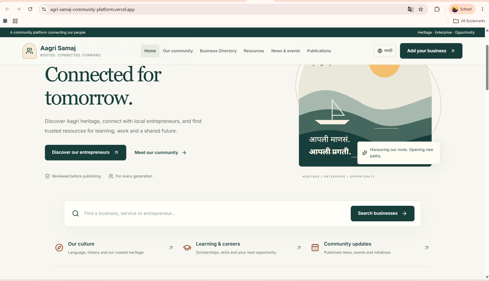

# आगरी समाज · Agri Samaj

A Marathi-English community platform for discovering local businesses, sharing publications and events, and managing business registrations. This is community work, developed around the Agri Samaj community's requirements.

[Visit the website](https://agri-samaj-community-platform.vercel.app) · [Application routes](src/app) · [Database schema](prisma/schema.prisma) · [CI](.github/workflows/ci.yml)



## What the platform does

- **Community discovery:** Marathi-English pages about Agri history, language, culture, organisations and initiatives, with links to official education, scholarship, employment and entrepreneurship resources.
- **Business directory:** Search by name, category, district or business type. Open public profiles, share search filters as URLs and save businesses to a private account shortlist.
- **News and publications:** Search published updates, browse upcoming or past events, download event calendar files and open community publication PDFs.
- **Business registration:** Create an account, save an application draft, attach supporting documents and track its review. Only approved businesses appear in public search.
- **Advertisements:** Choose a package, submit artwork and a payment reference, and follow an administrator-reviewed booking process.
- **Administration:** Review applications, request changes, approve or reject listings, manage categories, review advertisements and payment references, publish content, and handle inquiries.
- **Bilingual assistance:** Ask questions in Marathi or English, review recorded-question transcripts, read source-linked answers and listen to generated voice replies.

## Architecture

```text
Next.js / React interface
  ├─ Server-rendered public pages → bounded directory and community queries
  ├─ Member routes → session validation → owned business drafts and uploads
  ├─ Admin routes → role checks → review decisions and audit records
  └─ Assistant routes → persistent admission → public context → OpenAI
                                   ↓
                         Prisma / PostgreSQL
                  Private files: Vercel Blob or local storage
```

| Engineering decision | Implementation |
|---|---|
| Separate public and private records | Public queries select approved records; draft documents and owner fields have separate access checks. |
| Enforce ownership on the server | Business mutations validate the account and uploaded-file ownership before storing profile and audit changes in a transaction. |
| Recheck account state | JWT verification checks algorithm, issuer, audience and expiration; authenticated requests also load the active account and role. |
| Bound reads and shared traffic | Directory and admin queries use bounded pagination; PostgreSQL-backed counters enforce limits across application instances. |
| Keep AI within the website's scope | Context comes from public content and approved listings. Returned source identifiers are checked against the retrieved set. The assistant cannot read private applications or execute account actions. |
| Control generated voice | Voice replies require a signed, expiring token for a generated answer; provider calls receive cancellation signals and timeouts. |

See [authentication](src/lib/auth.ts), [business registration](src/app/api/businesses/register/route.ts), [request validation and limits](src/lib/http.ts), [assistant admission](src/lib/assistant-admission.ts), and [assistant source validation](src/app/api/assistant/chat/route.ts).

## Stack

Next.js App Router, React, TypeScript, Tailwind CSS, Prisma, PostgreSQL, Zod, bcrypt, JWT sessions, private Vercel Blob storage, OpenAI, Playwright and Node's test runner.

## Run locally

Use Node.js 22.x and a PostgreSQL database dedicated to this application.

```powershell
git clone https://github.com/harshgavandit/agri-samaj-community-platform.git
cd agri-samaj-community-platform
npm ci
Copy-Item .env.example .env
```

Configure `.env` before continuing:

| Variables | Purpose |
|---|---|
| `DATABASE_URL`, `DIRECT_URL` | PostgreSQL runtime and migration connections. Remote connections must require TLS. |
| `JWT_SECRET` | A unique cryptographically random secret of at least 32 characters. |
| `APP_URL`, `NEXT_PUBLIC_APP_URL` | `http://localhost:3000` locally; the HTTPS origin when hosted. |
| `ADMIN_EMAIL`, `ADMIN_PASSWORD`, `ADMIN_NAME` | Administrator details for seeding. Use a unique password of 12–72 bytes. Existing accounts are not overwritten. |
| `UPLOAD_DIR` | Optional private durable directory for local uploads, outside `public/`. |
| `BLOB_READ_WRITE_TOKEN` | Private Blob store on Vercel; keep it server-side. |

```powershell
npm run check:env
npm run prisma:generate
npm run db:deploy
npm run prisma:seed
npm run dev
```

Migrations and seeding write to the configured application database. Use a local development database. Open `http://localhost:3000`.

The assistant is optional. Set `OPENAI_API_KEY` and `OPENAI_MODEL` to enable it. Voice settings are `OPENAI_TRANSCRIPTION_MODEL` and `OPENAI_VOICE_MODEL`; `ASSISTANT_HOURLY_LIMIT` bounds shared provider operations. Other website features do not require a provider key. See [`.env.example`](.env.example) for the complete variable list.

## Verification

```powershell
npm run lint
npm run type-check
npm test
npm run build
npx playwright install chromium
npm run test:e2e
```

Browser tests need a dedicated **local** PostgreSQL server. Set `E2E_DATABASE_URL` if the default `127.0.0.1:5547/agri_test` is unavailable. The runner creates an isolated schema and synthetic fixtures; never point tests at the deployed application database. Normal tests disable provider calls. Live AI and Blob checks are explicit opt-ins in [the runner](tests/run-e2e.mjs).

[CI](.github/workflows/ci.yml) starts PostgreSQL and runs lint, type checks, unit tests, dependency audit, production build and browser journeys. Regressions cover registration/upload ownership, withdrawn-image privacy, directory filtering, private shortlists, admin pagination, session validation, request bounds and assistant controls.

## Operational scope

- Business and advertisement publication requires administrator review. Advertisement payment references are reviewed manually; this is not an automated payment processor.
- The assistant uses published website content. It has no live web search and cannot approve applications, verify payments or change accounts.
- The community's administrators determine content and roadmap. No official government endorsement, adoption metric or production service-level guarantee is implied.
- On Vercel, use PostgreSQL and a **private** Blob store. Local filesystem uploads require durable private storage when self-hosting.

## Repository map

| Path | Contents |
|---|---|
| `src/app/` | Public pages, member/admin interfaces and API routes |
| `src/lib/` | Auth, validation, public data, storage and AI boundaries |
| `prisma/` | PostgreSQL schema, migrations and controlled seed data |
| `tests/` | Unit, security and Playwright regression tests |
| `scripts/` | Environment checks, deployment and maintenance helpers |

Released under the [MIT license](LICENSE).
