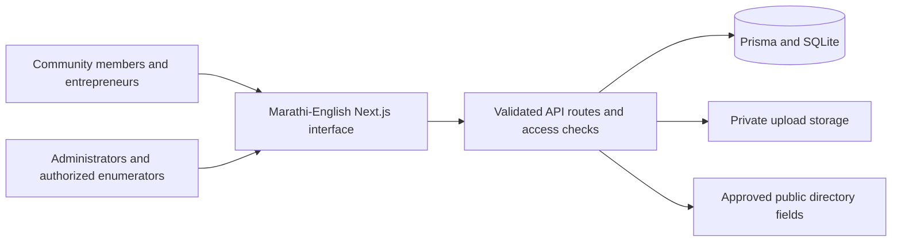

# आगरी समाज · Agri Samaj Community Platform

[](https://github.com/harshgavandit/agri-samaj-community-platform/actions/workflows/ci.yml)
[](LICENSE)

**An open-source platform built to help the Agri Samaj community connect, support local entrepreneurs, and make community services easier to access.**

आगरी समाजातील उद्योजक, व्यावसायिक, स्वयंसेवक आणि समाजबांधवांना एकत्र जोडण्यासाठी हे मुक्त-स्रोत डिजिटल व्यासपीठ तयार केले आहे. मराठी आणि इंग्रजीमधून व्यवसाय शोधणे, उद्योजकांना प्रोत्साहन देणे, उपक्रमांची माहिती मिळवणे आणि समाजाच्या कार्यात सहभागी होणे हा या प्रकल्पाचा उद्देश आहे.

## Why this project exists

Community businesses grow when people can find and support one another. This project brings business discovery, entrepreneur registration, publications, announcements, and administrative workflows into one accessible Marathi–English website. It is intended to be useful to local entrepreneurs, service providers, community organizations, volunteers, and the people they serve.

Agri Samaj refers to the **Agri community** across many professions and industries. The platform is not limited to agriculture. Its open-source model lets community members inspect the code, improve Marathi content and accessibility, contribute fixes, and adapt the software for local needs.

The platform references the history and programs of Akhil Aagri Samaj Parishad. This repository is a community software initiative; publication of the code does not itself establish institutional endorsement or authorization to represent an organization.

## What the platform does

| For                      | Available features                                                                                                                                                                      |
| ------------------------ | --------------------------------------------------------------------------------------------------------------------------------------------------------------------------------------- |
| Community members        | Browse approved businesses without an account; search and filter by business category, location, and classification; read publications and announcements; contact the community office. |
| Entrepreneurs            | Create an account, register a business through a five-step application, save and resume drafts, upload private verification documents, and track application or advertisement status.   |
| Community administrators | Review business applications, request revisions, manage categories and advertisement rates, review payments manually, maintain publications and announcements, and resolve inquiries.   |
| Authorized survey teams  | Use an optional restricted census tracker for aggregate household and questionnaire counts. The module is disabled by default.                                                          |
| Contributors             | Improve the interface, Marathi and English wording, accessibility, security, documentation, and automated tests through issues and pull requests.                                       |

This is a working full-stack application: forms persist to a relational database, access checks run on the server, and administrative actions are auditable. New installations start without fabricated businesses, events, publications, or advertising rates.

## Architecture



## Stack and runtime

- Next.js 15.5.28 App Router, React 19, TypeScript, Tailwind CSS 4, and locally bundled Inter / Noto Sans Devanagari fonts.
- Prisma 5 with **SQLite**, versioned SQL migrations, database-backed rate limits, and audit logs.
- JWT sessions in HttpOnly cookies; authorization checks use the current active database account and role.
- Private disk storage for uploads, authenticated file access, and publicly accessible logos only after business approval.
- Node.js 22 or newer. Tailwind 4 targets modern browsers: Chrome 111+, Safari 16.4+, and Firefox 128+.

This checkout uses SQLite. Changing a database URL alone does not enable PostgreSQL; that requires a separate provider migration and verification. SQLite and file uploads require durable storage on one application host. Deploying to ephemeral serverless storage or multiple independent replicas requires a deliberate database/storage redesign.

## Fresh installation

```powershell
git clone https://github.com/harshgavandit/agri-samaj-community-platform.git
cd agri-samaj-community-platform
npm ci
Copy-Item .env.example .env
# Edit .env with a real ADMIN_EMAIL, unique ADMIN_PASSWORD, and random JWT_SECRET.
# Generate a secret locally: node -e "console.log(require('crypto').randomBytes(48).toString('hex'))"
npm run prisma:generate
npm run db:init
npm run db:deploy
npm run prisma:seed
npm run check:env
npm run dev
```

On Linux or macOS, use `cp .env.example .env` for the environment-file copy step; the Git, npm, and Prisma commands are the same.

Open <http://localhost:3000>. Sign in with the administrator credentials you configured in your own environment. Seed creates business categories and the explicitly configured administrator, preserving existing records. It does **not** fabricate member accounts, approved businesses, events, publications, or advertising rates. Create real rates in `/admin/advertisements` and approved publication records in `/admin/publications`. New rates and publications start unpublished in the management UI.

Set `DATABASE_URL="file:./dev.db"` for the default local database; Prisma resolves this relative to `prisma/`. `db:init` creates a missing empty SQLite file without replacing an existing file, including the Windows initialization required by the Prisma engine. SQL migrations create the schema.

## Configuration and credentials

| Variable                                      | Purpose                                                                                                                                                              |
| --------------------------------------------- | -------------------------------------------------------------------------------------------------------------------------------------------------------------------- |
| `DATABASE_URL`                                | SQLite file on durable disk; excluded from Git.                                                                                                                      |
| `JWT_SECRET`                                  | Unique random secret of at least 32 characters. Missing, short, and retired sample secrets fail closed.                                                              |
| `APP_URL`                                     | Exact browser origin, including scheme and development port; used for same-origin mutation checks. Use HTTPS in production.                                          |
| `NEXT_PUBLIC_APP_URL`                         | Public URL fallback; must agree with the deployment origin.                                                                                                          |
| `ADMIN_EMAIL`, `ADMIN_PASSWORD`, `ADMIN_NAME` | Explicit initial administrator settings. Seeding never resets existing accounts.                                                                                     |
| `ENABLE_SURVEY_MODULE`                        | Server-side census access switch; defaults to the legacy public toggle if unset. Keep false unless authorized for real survey work.                                  |
| `NEXT_PUBLIC_ENABLE_SURVEY_MODULE`            | Legacy compatibility setting.                                                                                                                                        |
| `TRUST_PROXY`                                 | Defaults false. Set true only behind an ingress that replaces client-supplied `X-Forwarded-For`. Otherwise anonymous requests share a conservative admission bucket. |
| `UPLOAD_DIR`                                  | Private durable directory outside `public/`; defaults to `storage/uploads`.                                                                                          |

Use unique administrator credentials and a random session secret for each installation. There are no shared demo logins. Retired sample passwords are refused; existing installations that used sample credentials must reset affected accounts before use.

For an authorized account reset, supply `RESET_EMAIL` and a new `RESET_PASSWORD` through the process environment and run `node scripts/reset-password.mjs`. The script validates the password, updates its bcrypt hash, and records the action. Never place passwords in source control, issue bodies, or shell arguments. There is no email-based password recovery integration in this checkout.

Environment files, databases, uploads, backups, and browser artifacts are excluded from version control. The public repository starts from a clean source snapshot; earlier local development history is not published. Never commit real credentials, member records, or verification documents.

## Existing database upgrades

Back up the database before any deployment. For an existing database created with `prisma db push`, first compare its schema with the baseline migration. Mark `202610160001_baseline` as applied **only after confirming an exact match**, then deploy the additive migration:

```powershell
npx prisma migrate diff --from-url "file:./prisma/dev.db" --to-schema-datamodel prisma/baseline.prisma --exit-code
# Continue only if the schema comparison exits 0 (no difference).
npx prisma migrate resolve --applied 202610160001_baseline
npm run db:deploy
npm run db:status
```

Do not baseline a mismatched schema, run a reset, or use `db push --accept-data-loss`. Reconcile any drift with a reviewed migration. The upgrade path was checked against the local development database after taking a backup. All existing rows in its ten original tables were verified unchanged before a separate administrator credential rotation. Make and verify your own backup when upgrading another installation.

The security migration adds upload ownership metadata, persistent admission counters, and business/booking indexes. It does not delete or rewrite existing application records. Historical `/uploads/` files are no longer served; new uploads use `/api/files/:id`. Any legacy document URLs require a reviewed owner-to-file migration and re-upload before use; do not copy confidential files back into `public/`.

## Workflows and security behavior

- Browsing and filtering approved businesses requires no account. Search is debounced and obsolete requests are cancelled. Pagination and search inputs are bounded server-side.
- Business submissions and drafts require authentication and ownership. There is no email-based implicit account creation. Drafts persist in the database rather than shared-browser local storage. Editing an approved listing sends it back to review.
- Public directory responses use an explicit field allowlist, exclude verification documents and internal account/review fields, and omit exact office/factory addresses when the owner marks them private. Public phone/email fields are distinct from private owner contact fields.
- Uploads require authentication, a supported MIME type matching the file signature, a nonempty file, and a 5 MB limit. Private documents are downloadable only by their owner or an administrator. PDF downloads are attachments with a restrictive sandbox policy. File contents are not antivirus scanned.
- Booking prices are read from active database packages. A submitted transaction reference **never verifies payment**. An administrator performs manual payment review; no card charge, gateway settlement, bank reconciliation, or automatic refund is implemented.
- Administrator changes and their audit records commit in the same database transaction. Admin screens report failed requests, prevent repeated submissions while saving, and provide keyboard-accessible dialogs.
- Census records are aggregate counts restricted to administrators/enumerators. The server switch blocks reads and writes when disabled; it is not merely a visual notice. Household and questionnaire counts are validated. Do not place personal household data in free-text notes.
- API mutations enforce same-origin browser requests, bounded JSON bodies, typed validation, and sanitized errors. Admission limits persist in the database and fail closed if it is unavailable. Security headers include CSP, nosniff, frame restrictions, permissions policy, and production HSTS. CSP retains inline script support required by this Next.js rendering setup.
- Marathi/English selection updates the document language and survives navigation. Forms have associated labels, visible keyboard focus, mobile touch targets, reduced-motion support, skip navigation, and visible loading/error states.

## Verification

```powershell
npm run lint
npm run type-check
npm test
npm audit --audit-level=moderate
npm run build
npx playwright install chromium
npm run test:e2e
```

The end-to-end runner creates a new database and private upload directory under ignored `storage/e2e/<run-id>/`, applies both migrations, configures a random test administrator, starts the actual production server, and drives Chromium. Test fixtures exist only in that disposable database. It does not write to the application database or use mocked success responses. Keep the production build current before running it. `E2E_PORT` can select a free alternative to port 3107. Server logs and database evidence remain in the ignored run directory for diagnosis.

Verification as of 16 October 2026:

| Check                                  | Result                                                                                                                                                                                                       |
| -------------------------------------- | ------------------------------------------------------------------------------------------------------------------------------------------------------------------------------------------------------------ |
| Environment preflight                  | Passed with installation-specific credentials.                                                                                                                                                               |
| Existing database upgrade              | Passed; additive migration applied, original records preserved.                                                                                                                                              |
| Isolated migration deployment          | Both migrations applied successfully.                                                                                                                                                                        |
| Application unit tests                 | 15 passed, including authentication, validation, privacy, upload signatures, localization, and currency precision.                                                                                           |
| ESLint                                 | Passed with zero warnings.                                                                                                                                                                                   |
| TypeScript                             | Passed.                                                                                                                                                                                                      |
| Dependency audit                       | Zero known vulnerabilities.                                                                                                                                                                                  |
| Production build                       | Passed with all production routes generated and TypeScript validation complete.                                                                                                                              |
| Browser/API journeys and accessibility | 10 passed; 52 responsive page checks at 375/768/1280/1536px; no serious or critical axe violations on 13 public pages/account gates; no browser page or console errors during normal public-page navigation. |

The successful browser run had zero skipped, unexpected, or flaky tests. It covers registration, draft resume, private uploads, approval and public search, contact resolution, booking and manual payment review, category/rate/publication management, census validation, announcements, failed login, logout, enumerator access, authorization/privacy failures, CSRF, and persistent admission. The operator password reset script was exercised against the isolated administrator. Separately, the upgraded local development database passed health, directory, rotated-admin login, protected statistics, and disabled-census read/write checks.

Browser reports and desktop/mobile screenshots are in ignored `test-results/`. These screenshots contain clearly identified test fixtures from the disposable database.

The [GitHub Actions workflow](https://github.com/harshgavandit/agri-samaj-community-platform/actions/workflows/ci.yml) runs dependency installation, Prisma generation, lint, TypeScript, unit tests, dependency audit, production build, and Chromium journeys. The badge at the top shows the latest published workflow status; the table above records the local verification baseline.

## Deployment and remaining operational boundaries

```powershell
npm ci
npm run prisma:generate
npm run check:env
npm run db:deploy
npm run build
npm start
```

Configure HTTPS, exact `APP_URL`, durable database and private-upload volumes, a trusted reverse proxy with request-size limits, and database/upload backups before exposing the site. Use `/api/health` for database-backed readiness; a failed database query returns 503. Restrict filesystem access to backups, test artifacts, and environment files. Do not deploy test fixtures or the development database.

This audit verifies local application behavior and isolated persistence, not a public production deployment. Institutional contact details, existing business listings, historical publication permissions, and current advertising rates require approval from the organization; existing seeded-looking records were preserved rather than claimed as independently verified. External PDF URL availability, email delivery, physical mobile devices, backup restoration on the deployment host, production load behavior, and production infrastructure have not been verified. Apply an appropriate upload malware-scanning and retention policy before accepting sensitive real documents at scale.

The framework update follows the [14 October 2026 Next.js security advisory](https://nextjs.org/blog/nextjs-security-update-october-14-2026). Tailwind migration follows the [official upgrade guide](https://tailwindcss.com/docs/upgrade-guide).

## Contributing

Contributions that make the platform more useful to the Agri Samaj community are welcome. Helpful starting points include Marathi copy improvements, mobile and keyboard usability, accurate community-approved content, clearer onboarding, bug fixes, and stronger regression coverage.

1. Look through [issues](https://github.com/harshgavandit/agri-samaj-community-platform/issues) or open one describing the problem, expected behavior, and who it affects. Check existing discussions before starting a large change.
2. Fork the repository, create a focused branch, and keep changes small enough to review. Preserve Marathi and English behavior and existing data privacy boundaries.
3. Add meaningful regression coverage for behavior changes. Use synthetic test-only records; never attach real personal documents, passwords, member databases, or financial details to an issue or pull request.
4. Run lint, TypeScript, unit tests, the production build, and relevant browser journeys before submitting a pull request. Explain what changed and how you verified it.

Please communicate respectfully and make room for contributors with different technical and language backgrounds. Community benefit, accessibility, and trustworthy handling of personal information are the priorities.

For a security concern, use the repository's private vulnerability reporting feature when available. Avoid publishing exploit details or personal data in a public issue. For regular bugs and feature ideas, use public issues or [discussions](https://github.com/harshgavandit/agri-samaj-community-platform/discussions).

## License and community content

The original application source code and project documentation are released under the [MIT License](LICENSE). Copyright 2026 Harsh Gavand and contributors. You can use, study, adapt, and share the software under that license's terms.

The software license does not grant rights to third-party dependencies, institutional names or marks, historical reference scans, publication contents, business listings, uploaded documents, or personal information. Those materials retain their respective owners' rights and require the relevant permission before reuse or redistribution. The supplied historical scan is retained as a reference asset, not re-licensed as MIT software. Verify publication permissions before making archival documents available in a deployment.

**Built to help the Agri Samaj community. Improved together through open collaboration.**
